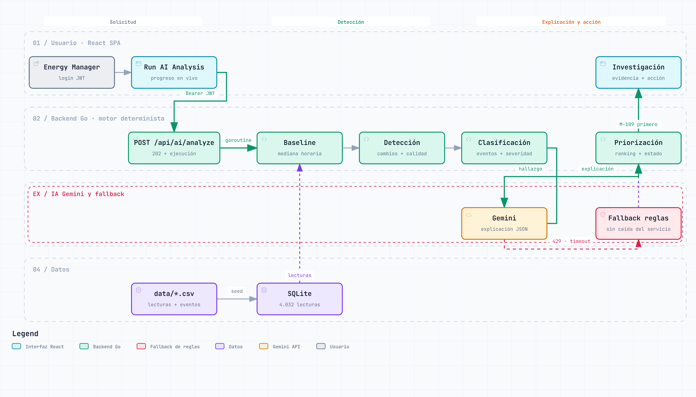
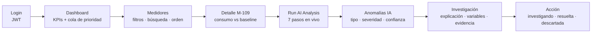
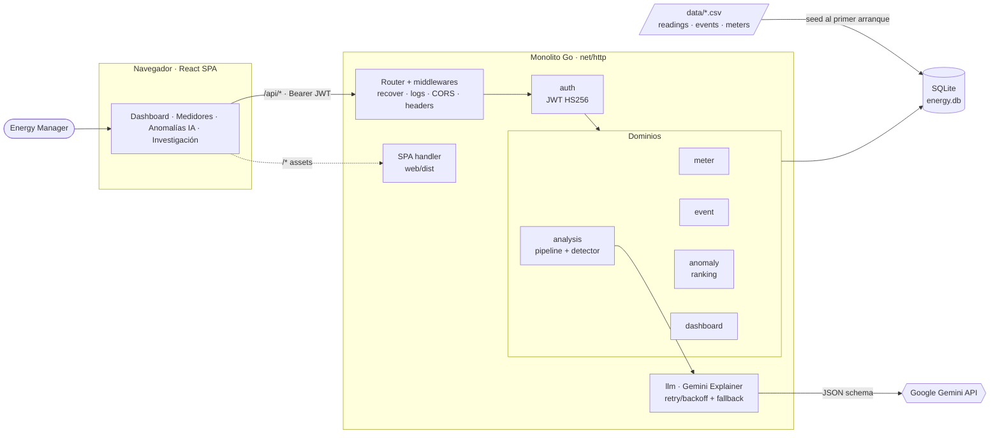
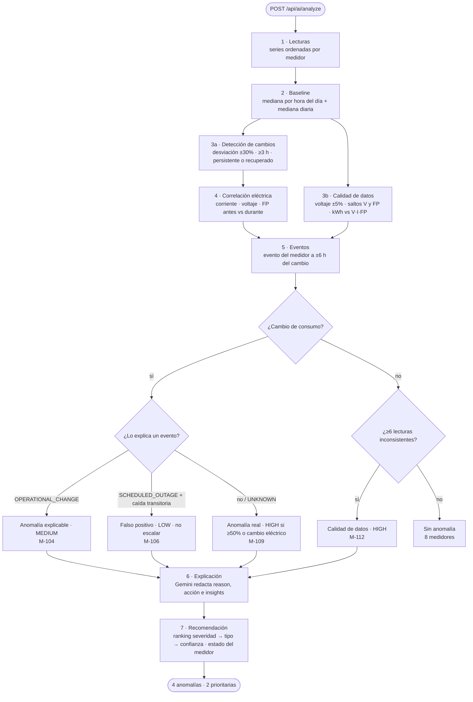
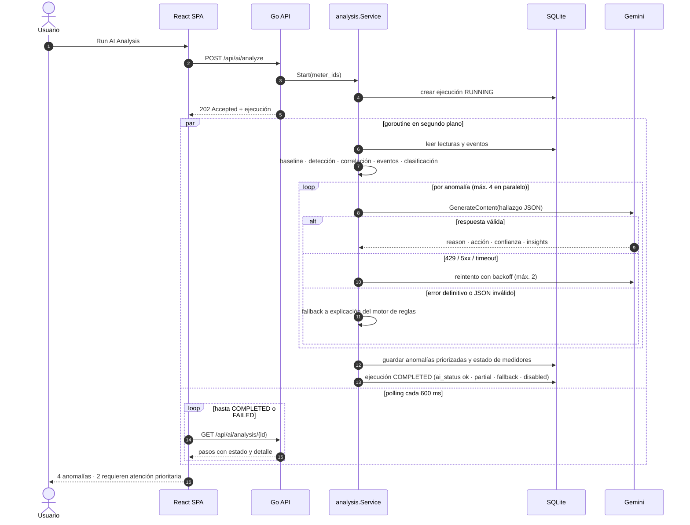

# Voltia · AI Energy Management Platform

MVP end-to-end para gestionar 12 medidores eléctricos (14 días, 4.032 lecturas horarias) que **detecta, explica, prioriza y recomienda acciones** sobre anomalías de consumo, voltaje, corriente y factor de potencia.

```
DATOS → ANÁLISIS → ANOMALÍA → EXPLICACIÓN → PRIORIZACIÓN → ACCIÓN
```

| Medidor | Caso del dataset | Resultado del motor |
|---|---|---|
| M-109 | +109% sin evento conocido, corriente ×2, FP 0,94→0,74 | **Anomalía real · High · prioridad 1** |
| M-112 | Consumo estable, voltaje 202–241 V y FP 0,58–0,99 alternando | **Calidad de datos · High** |
| M-104 | +47% desde la activación de una nueva línea productiva | **Anomalía explicable · Medium** |
| M-106 | −80% durante 12 h de parada programada, luego se recupera | **Falso positivo · Low · no se escala** |

Los 8 medidores restantes no generan alertas. Resultado: *4 anomalías detectadas · 2 requieren atención prioritaria*.

### Flujo del proyecto

<picture>
  <source media="(prefers-color-scheme: dark)" srcset="docs/diagrams/project-flow-dark.png">
  
</picture>

Diagrama generado con [Archify](https://github.com/tt-a1i/archify). Versión interactiva (zoom, búsqueda, trazado de relaciones y exportación): [`docs/diagrams/project-flow.html`](docs/diagrams/project-flow.html), que se abre en local en el navegador. Fuente editable: [`project-flow.workflow.json`](docs/diagrams/project-flow.workflow.json).

### Flujo de uso



---

## Arquitectura

Monolito en un único repositorio: un binario Go expone la API REST bajo `/api` y sirve la SPA de React compilada.



### Estructura

```
cmd/server/main.go              Inyección de dependencias, seed y apagado controlado
internal/
  analytics/                    Funciones puras de series temporales (mediana, perfiles, totales)
  domain/
    meter/                      Entidad, repositorio SQLite, servicio (filtros/orden) y handlers
    reading/  event/            Lecturas y eventos operativos
    anomaly/                    Entidad, ranking de prioridad, estados y handlers
    analysis/                   Motor de anomalías, pipeline de 7 pasos, ejecuciones y handlers
    dashboard/                  KPIs agregados
    auth/                       Login demo con JWT (HS256) y middleware
  platform/
    config/ database/ dataset/ seed/ httpx/ middleware/ server/
    llm/                        Integración con Gemini (google.golang.org/genai)
migrations/                     Esquema SQL embebido
data/                           readings.csv, events.csv, meters.csv
web/                            Frontend React
```

Cada dominio sigue Clean Architecture ligera: entidad → servicio → repositorio (interfaz del lado consumidor) → handler HTTP.

---

## Motor de anomalías

Pipeline ejecutado por `POST /api/ai/analyze`, visible paso a paso en la UI:

1. **Lecturas**: carga y ordena las series por medidor.
2. **Baseline**: perfil horario robusto (mediana por hora del día) y consumo diario de referencia (mediana de días completos). La mediana ignora los días anómalos, así que no requiere una ventana "limpia".
3. **Detección**: desviación horaria frente al perfil (umbral ±30%). Agrupa horas consecutivas (tolerando huecos de 2 h), exige ≥3 h y marca el cambio como *persistente* si llega al final de la serie. En paralelo, la **calidad de datos** revisa voltaje fuera de 220 V ±5%, saltos >10 V, saltos de FP >0,15 y energía incoherente (`kWh / (V·I·FP)` fuera de [0,6, 1,6]).
4. **Correlación**: compara voltaje, corriente y FP de las 72 h previas con la ventana del cambio.
5. **Eventos**: busca eventos del medidor a ±6 h del cambio. `OPERATIONAL_CHANGE` explica un cambio; `SCHEDULED_OUTAGE` explica una caída transitoria; `UNKNOWN` no explica nada.
6. **Explicación**: Gemini redacta la explicación, los hallazgos y la recomendación a partir de la evidencia estructurada.
7. **Recomendación**: ranking global (severidad → tipo → confianza), persistencia y estado del medidor.



**Clasificación**: un cambio explicado por un evento da *Explicable/Medium* o *Falso positivo/Low*. Un cambio sin explicación da *Anomalía real*, con severidad *High* si supera el 50% o altera la firma eléctrica. Sin cambio de consumo pero con ≥6 lecturas inconsistentes da *Calidad de datos/High*.

**Confianza**: heurística trazable, por ejemplo magnitud, persistencia, cambio eléctrico o alineación con el evento.

### Rol de la IA (híbrido con fallback)




- El motor determinista decide **tipo y severidad**. Es reproducible y testeable, y garantiza el resultado de M-109 y M-106.
- **Gemini** recibe el hallazgo como JSON (cifras, ventana, variables, evento, evidencia) con un esquema de respuesta obligatorio y devuelve `reason`, `recommended_action`, `confidence` e `insights`. Solo puede mover la confianza ±0,10.
- Errores 429 y 5xx: hasta 2 reintentos con backoff exponencial. Timeout: 20 s por llamada. 401/403/404 no se reintentan. Una respuesta vacía, bloqueada o con JSON inválido se considera inválida.
- Ante cualquier fallo, la anomalía conserva la explicación del motor de reglas, se marca `source: rules` con `ai_error` y la ejecución informa `ai_status` = `ok | partial | fallback | disabled`. **El sistema nunca queda sin respuesta.**

---

## API

Todas las rutas (excepto login y health) requieren `Authorization: Bearer <token>`.

| Método | Ruta | Descripción |
|---|---|---|
| POST | `/api/auth/login` | Login demo → JWT |
| GET | `/api/auth/me` | Usuario actual |
| GET | `/api/health` | Health check |
| GET | `/api/meters?status=all\|normal\|alert\|critical&search=&sort=consumption\|variation\|severity&order=` | Listado con filtros |
| GET | `/api/meters/:meterId` | Detalle, consumo diario vs baseline, eventos y anomalías |
| GET | `/api/meters/:meterId/readings?granularity=hour\|day&from=&to=` | Serie con consumo esperado |
| GET | `/api/events?meter_id=` | Eventos operativos |
| GET | `/api/anomalies?severity=&type=&status=&meter_id=` | Anomalías priorizadas |
| GET | `/api/anomalies/:id` | Investigación completa |
| PATCH | `/api/anomalies/:id` | `{ "status": "INVESTIGATING\|RESOLVED\|DISMISSED\|OPEN" }` |
| POST | `/api/ai/analyze` | `{ "meter_ids": ["M-109"] }` opcional → 202 + ejecución |
| GET | `/api/ai/analysis/:id` | Estado paso a paso de la ejecución |
| GET | `/api/ai/analysis/latest` | Última ejecución |
| GET | `/api/dashboard/summary` | KPIs del dashboard |

---

## Ejecución local

**Requisitos:** Go ≥ 1.26, Node ≥ 20.19 (probado con 24) y npm.

```bash
git clone <repo> && cd AI_energy_management_platform
cp .env.example .env               # opcional: agrega GEMINI_API_KEY
go mod download
cd web && npm ci && cd ..
```

**Opción A: modo desarrollo** (hot reload, dos terminales):

```bash
go run ./cmd/server                # API en http://localhost:8080
cd web && npm run dev              # UI en http://localhost:5173 (proxy /api → 8080)
```

**Opción B: monolito** (como en producción):

```bash
cd web && npm run build && cd ..
go build -o bin/server ./cmd/server      # en Windows: bin/server.exe
./bin/server                              # http://localhost:8080
```

Credenciales demo: `admin@energia.demo` / `demo1234`.

Al primer arranque se crea `energy.db` y se cargan los CSV de `data/`. Para reiniciar la demo, borra `energy.db*`. Sin `GEMINI_API_KEY`, la app funciona igual con las explicaciones del motor de reglas. La key se obtiene gratis en https://aistudio.google.com/apikey.

### Variables de entorno

| Variable | Default | Descripción |
|---|---|---|
| `PORT` | `8080` | Puerto HTTP |
| `APP_ENV` | `development` | `production` exige `JWT_SECRET` (≥32 caracteres) y activa logs JSON |
| `DATABASE_PATH` | `energy.db` | Archivo SQLite |
| `DATA_DIR` | `data` | CSV de seed |
| `STATIC_DIR` | `web/dist` | Build del frontend |
| `GEMINI_API_KEY` | vacío | Habilita Gemini |
| `GEMINI_MODEL` | `gemini-2.5-flash` | Modelo |
| `GEMINI_TIMEOUT` | `20s` | Timeout por llamada |
| `JWT_SECRET` / `TOKEN_TTL` | dev / `12h` | Firma y vigencia de sesión |
| `DEMO_EMAIL` / `DEMO_PASSWORD` / `DEMO_NAME` | demo | Usuario demo |
| `ANALYSIS_STEP_DELAY` | `400ms` | Pausa entre pasos para visualizar el progreso (`0s` para desactivar) |
| `ALLOWED_ORIGINS` | vacío | CORS si el frontend se sirve desde otro dominio |

### Tests

```bash
go test ./...                       # unitarios + integración con el dataset real
go test -cover ./...
```

El backend se desarrolló con TDD (el historial de git alterna commits `test:` y `feat:`). `internal/domain/analysis/dataset_test.go` valida contra `data/readings.csv` los 4 casos, que M-109 sea prioridad 1 y que los otros 8 medidores no generen alertas.

---